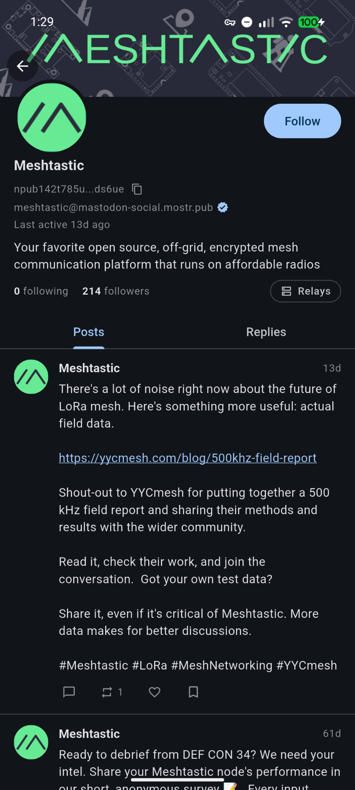
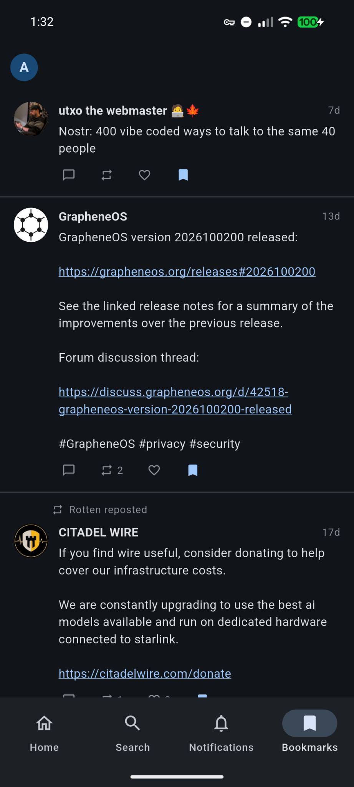

# Sputnik

A minimal, cross-platform [Nostr](https://nostr.org/) client for Android and Linux, written in Flutter.

> [!WARNING]
> This project is early and somewhat of a work-in-progress. Expect missing features, rough edges, and breaking changes between versions.

## Features

- **Privacy-focused:** anything that can leak your IP to third parties can be turned off
- **Security-hardened:** keys are kept in secure storage and wiped from memory after use
- **Not bloated:** small feature set and few dependencies
- Reasonably good performance
- Support for [a reasonable number of NIPs](./docs/NIPS.md)
- Licensed under [MIT](./LICENSE)

## Screenshots

| Profile page                                                            | Bookmarks page                                                            |
| ----------------------------------------------------------------------- | ------------------------------------------------------------------------- |
|  |  |

## What it can do (so far)

- Following and global feeds, with infinite scroll
- Threads, replies, reposts, quotes, and reactions
- Compose and publish notes, with a confirmation step before anything is signed
- Follow lists, profile editing, and your own relay list (NIP-65)
- Images and videos in notes, checked against their hash with Blossom fallback
- Bookmarks, multiple identities, and search by `npub`, `nprofile`, or note ID
- Payment targets on profiles (NIP-A3)

See [`docs/NIPS.md`](./docs/NIPS.md) for which NIPs are supported and [`docs/ROADMAP.md`](./docs/ROADMAP.md) for what is done and what is next.

## Platforms

| Platform | Status    | Package  |
| :------- | :-------- | :------- |
| Linux    | Supported | AppImage |
| Android  | Supported | APK      |
| macOS    | Planned   | -        |

There aren't any published releases yet; build from source as shown below.

## Building from source

Clone with the `secp256k1` submodule:

```sh
git clone --recurse-submodules https://github.com/sputnik-nostr/sputnik
cd sputnik
```

### Reproducible build (recommended)

Builds the Linux AppImage and unsigned Android APKs inside a pinned container, same as the CI does. Only Docker is needed on the host machine.

```sh
make dist
```

The outputs and a `SHA256SUMS` file end up in `dist/`.

### Local build

You need the [Flutter SDK](https://docs.flutter.dev/get-started/install) and, on Linux, the usual Flutter desktop dependencies plus `libmpv` (for video) and `libsecret` (for secure storage). On Debian or Ubuntu:

```sh
sudo apt install clang cmake ninja-build pkg-config libgtk-3-dev libmpv-dev libsecret-1-dev
```

Then:

```sh
flutter pub get
make run
```

## Development

| Command      | What it does                                        |
| :----------- | :-------------------------------------------------- |
| `make run`   | Run the app in release mode                         |
| `make test`  | Build the native library, then run the test suite   |
| `make check` | Formatting, analysis, and tests in the CI container |
| `make fmt`   | Format Dart, C, shell, YAML, Makefile, and Markdown |
| `make dist`  | Build release packages in the pinned container      |

Plain `flutter test` fails for anything that signs or generates keys, since the native library is not next to the test runner. Use `make test`, or point `SPUTNIK_NOSTR_SECP256K1_LIBRARY` at an already built `build/linux/x64/release/libnostr_secp256k1.so`.

## Contact

Matrix room: `#sputnik-nostr:matrix.org`

## License

[MIT](./LICENSE)
